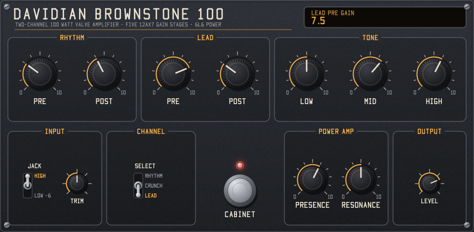

# Davidian Brownstone 100 — LV2 amp plugin

This is a mono Davidian LV2 guitar amp simulation of a classic late-1990s high-gain 120 W valve head, modeled stage by stage from its circuit. Plugin URI: `urn:davidian:brownstone-100`.

## Build

**Windows (MSVC):** run `build.bat`, or `build.bat test` to also run the offline tests. The script sets up the Visual Studio environment itself.
**Linux / macOS / MinGW:** run `make`, then `make test` and `make install` (installs to `~/.lv2`).

The output is the bundle `build/brownstone100.lv2/`. Copy it into an LV2 folder:

- Windows: `%APPDATA%\LV2` or `%COMMONPROGRAMFILES%\LV2`
- Linux: `~/.lv2`
- macOS: `~/Library/Audio/Plug-Ins/LV2`

The plugin works in hosts that load LV2 plugins, such as Reaper, Ardour, Carla and Qtractor.

## GUI

The panel is called **Brownstone 100**. It uses the house GUI style (graphite panel, cream lettering, amber accents, black knurled knobs, red footswitch LED). The style lives in `src/ui/style.h`, `font.h` and `canvas.h`. The panel has its own layout and name, and no branding from the original amp.

- **Knobs:** drag up or down. Hold Shift for fine control, use the mouse wheel for small steps, and double-click to reset.
- **Toggle switches:** click the position you want.
- **Cabinet footswitch:** turns the cabinet sim on or off.
- **Readout:** the window at the top right shows the control you last touched.

The GUI is a native window with its own software renderer, so it needs no graphics libraries. It uses `ui:WindowsUI` on Windows and `ui:X11UI` on Linux. macOS builds include the plugin without a GUI.

## Controls

| Control | Notes |
|---|---|
| Channel | Rhythm (with the K4B shunt), Rhythm Crunch (S1C), Lead (K1/K2/K4 energized) |
| Rhythm Pre / Post, Lead Pre / Post | 1M pots VR1/VR6 and VR2/VR7. Post sets how hard the power amp is driven (the original amp is very loud past 3) |
| Low / Mid / High | FMV tone stack: 1M / 50k / 250k, 47k slope, 470p / 22n / 22n |
| Presence / Resonance | Reduce high- or low-frequency negative feedback in the power amp |
| Low Input | J39 input (−6 dB) |
| Cabinet Sim | An approximate 4x12 speaker filter. Turn it off to use your own impulse response |
| Input Trim / Output | 0 dBFS at the input counts as 1 V peak at the guitar jack |

## What is modeled

- **Tubes:** each 12AX7 stage (V1A, V1B, V2A, V2B, V5B, V5A, V3A) uses the Koren triode equations solved on that stage's AC load line, using the circuit's plate, cathode and load resistors. This includes:
  - cutoff and saturation
  - grid conduction
  - frequency-dependent gain from the cathode bypass capacitor
  - the 39k "cold clipper" on V2A
- **Coupling network filters:** the coupling caps, the R11/C48 2 kHz roll-off, and the grid-stopper/Miller-capacitance low-pass filters (R82 470k, R7 220k, R88 1M).
- **Rest of the amp:**
  - V3B cathode follower
  - Yeh's exact tone stack equations
  - Long-tail phase inverter
  - 6L6GC push-pull class AB stage
  - Output transformer bandwidth
  - The negative feedback loop, solved implicitly every sample
- **Oversampling:** everything that distorts runs at 4x with 12th-order anti-alias filters.

## Approximations

- The relay and switch wiring around K4 and S1C isn't fully clear. These parts are reduced to their main effect:
  - In Rhythm, K4B shunts R23 39k + C63 0.1µF to ground (about −30 dB).
  - Crunch removes that shunt.
- These parts are behavioral models, not a component-level circuit solution:
  - The power section, which has no sag
  - The phase inverter
  - The cabinet filter
- The Pre/Post pots use a steep audio taper (the pots are marked "A3"). The rhythm-channel levels were tuned so the channel stays clean at Pre ≈ 1–2 and breaks up from about 4–5.

## Files

- `src/brownstone100.c`: the DSP code and LV2 entry point
- `src/ports.h`: port indices and URIs shared by the plugin and the GUI
- `src/lv2_core.h`: minimal LV2 ABI. Build with `-DHAVE_LV2` to use the system headers instead
- `src/ui/`: the GUI
  - `panel.h`: layout, drawing and mouse handling
  - `ui_lv2.c`: LV2 UI entry points and the Win32/X11 window layer
  - `style.h`, `font.h`, `canvas.h`: the house style
- `brownstone100.lv2/`: the TTL metadata
- `test/render.c`: offline DSP test. It renders a synthetic power-chord DI through each channel, checks for NaN and feedback-loop stability, and writes `build-test/test_*.wav`
- `test/ui_render.c`: renders the panel to a BMP without opening a window
- `test/ui_check.c`: loads `brownstone100_ui.dll` the way a Windows host does, clicks and drags the controls, and checks the values sent back (Windows only)
- `LICENSE`: GPL-3.0 text. `LICENSE-LV2`: the ISC notice for the re-declared LV2 interface

## References

The model re-implements equations from these published works. No code was copied from them.

1. N. Koren, "Improved vacuum tube models for SPICE simulations", *Glass Audio* 8(5), 1996. The triode equation and the 12AX7 parameters (μ = 100, Ex = 1.4, Kg1 = 1060, Kp = 600, Kvb = 300).
2. D. T. Yeh and J. O. Smith, "Discretization of the '59 Fender Bassman tone stack", *Proc. 9th Int. Conf. on Digital Audio Effects (DAFx-06)*, Montreal, 2006. The analytic tone stack transfer function and its bilinear discretization.
3. R. Bristow-Johnson, "Cookbook formulae for audio EQ biquad filter coefficients" (the Audio EQ Cookbook). The low-pass, high-pass and peaking filters in the anti-alias and cabinet filters.
4. V. Zavalishin, *The Art of VA Filter Design*, Native Instruments, 2012–2020. The topology-preserving one-pole filters, and the instantaneous response used to solve the power-amp feedback loop.
5. K. Karplus and A. Strong, "Digital synthesis of plucked-string and drum timbres", *Computer Music Journal* 7(2), 1983. Only used to make the test signal in `test/render.c`.

## Use of AI

This project was made with AI assistance. The code, tests, LV2 metadata, build scripts and this README were written by Claude (Anthropic's Claude Opus 5.5, through Claude Code), directed and reviewed by the author.

- **The author** supplied the circuit, the GUI house style, the names and the licensing choices. They also decided what to build and changed parts of the result themselves, including renaming the project to Brownstone 100.
- **The AI**:
  - read component values and topology from the circuit and chose which parts to simplify (see [Approximations](#approximations))
  - wrote the DSP model and set the rhythm-channel and pot-taper calibration
  - adapted the house-style GUI to this panel
  - wrote the test programs and documentation
- **Checking:** the results are checked by the automated tests in `test/`:
  - numerical stability of the DSP, levels and speed
  - harmonic content per channel
  - the GUI loaded and driven by simulated mouse input
- **Not checked:** the sound hasn't been compared with a real amplifier. The calibrated values (channel attenuations, pot tapers, cabinet filter, power-amp constants) are the AI's estimates. They should be tuned by ear.

## License

Copyright (C) 2026 Davidian

This program is free software: you can redistribute it and/or modify it under the terms of the GNU General Public License as published by the Free Software Foundation, either version 3 of the License, or (at your option) any later version. It is distributed in the hope that it will be useful, but WITHOUT ANY WARRANTY; without even the implied warranty of MERCHANTABILITY or FITNESS FOR A PARTICULAR PURPOSE. See [LICENSE](LICENSE) for the full text.

## Third-party licences

| Component | Licence | How it's used |
|---|---|---|
| LV2 C interface (`lv2/core/lv2.h`, `lv2/ui/ui.h`) | ISC | Its declarations are re-stated in `src/lv2_core.h`, the UI ABI block of `src/ui/ui_lv2.c` and `test/ui_check.c`, so no LV2 SDK is needed. Copyright and permission notice in [LICENSE-LV2](LICENSE-LV2). |
| LV2 vocabularies (`lv2core`, `ui`, `units`, `port-props`) | ISC | The `.ttl` files refer to them by URI. Nothing is copied. |
| Microsoft C runtime | Visual Studio licence | `build.bat` links it statically (`/MT`) into the DLLs you build. It counts as a system library under the GPL, so this is allowed. No binaries are committed to this repository. |

Every source file starts with an SPDX licence line saying which of these applies.

This project is not affiliated with or endorsed by the maker of the original amplifier. Product names in cited paper titles are trademarks of their owners.
